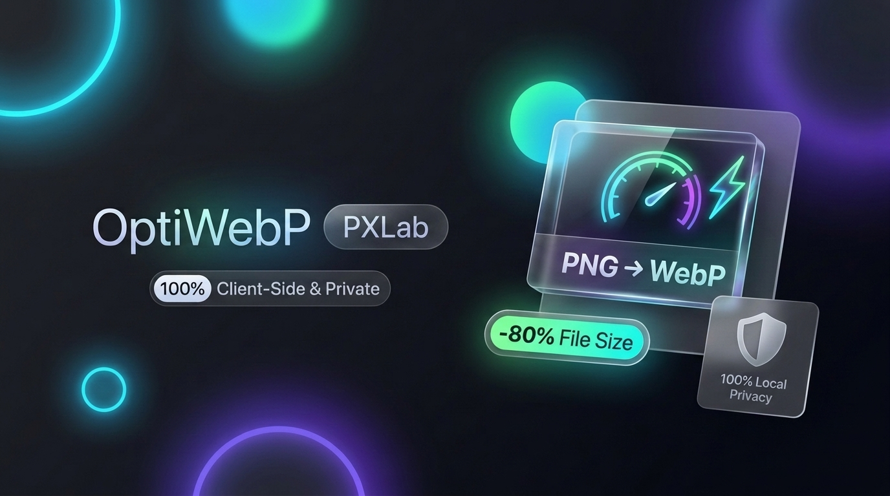

<p align="center">
  
</p>

<p align="center">
  <strong>Ultra-fast, private, client-side WebP image converter & optimizer.</strong>
</p>

<p align="center">
  <a href="https://webp.pxlab.ir/"></a>
  <a href="LICENSE"></a>
  
  
</p>

<p align="center">
  🚀 <strong>Try it live: <a href="https://webp.pxlab.ir/">https://webp.pxlab.ir</a></strong>
</p>

<p align="center">
  🌐 <strong><a href="README.md">English</a></strong> • <strong><a href="README.fa.md">فارسی</a></strong>
</p>

---

## ⚡ Overview

**OptiWebP** is a modern, high-performance web workstation designed to convert and compress images (PNG, JPG, GIF, WebP) directly into optimized WebP format right in your browser.

Engineered with an Apple-inspired **liquid glassmorphism** dark aesthetic, it requires **zero server infrastructure**, guarantees complete privacy, and processes images instantly leveraging hardware acceleration (Canvas / GPU).

---

## ✨ Key Features

- 🔒 **100% Client-Side & Private**: Your images never touch a server or cloud bucket. Everything stays strictly inside your device's memory.
- ⚡ **Instant Processing**: Encodes images in parallel using browser hardware acceleration and Canvas APIs.
- 💰 **Zero Server Costs**: Completely static architecture. Host for free on **Cloudflare Pages**, **GitHub Pages**, or run fully offline.
- 🗂️ **Batch Queuing**: Drag & drop dozens of images at once. Manage queue items individually with instant removals.
- 🎛️ **Precision Control**:
  - Quality slider from 10% to 100%.
  - Pixel-perfect **Lossless mode** toggle.
  - Proportional image dimension resizing with aspect ratio lock.
- 🔄 **Live Re-encoding**: Adjust settings and re-encode the entire batch on the fly with a single click.
- 📦 **In-Memory ZIP Packaging**: Built-in zero-dependency archive generator compiles all converted WebP files into a single `.zip` instantly.
- 💎 **Liquid Glass UI**: Responsive ambient glow orbs, frosted glass specular reflections, and refined micro-interactions.

---

## 🚀 Deployment Guide

### Deploy to Cloudflare Pages (Recommended)

#### Option 1: Git-Connected Deploy (Automatic CI/CD)
1. Fork or push this repository to your GitHub account.
2. In the [Cloudflare Dashboard](https://dash.cloudflare.com/), go to **Workers & Pages** $\rightarrow$ **Create Application** $\rightarrow$ **Pages** $\rightarrow$ **Connect to Git**.
3. Select your repository `Opti-WebP`.
4. Configure build settings:
   - **Framework preset**: `None`
   - **Build command**: *(leave empty)*
   - **Build output directory**: `public`
5. Click **Save and Deploy**. Your site will be live on `https://<your-project>.pages.dev` with global edge caching and free SSL!

#### Option 2: Direct Drag & Drop
1. In Cloudflare Dashboard, go to **Workers & Pages** $\rightarrow$ **Create Application** $\rightarrow$ **Pages** $\rightarrow$ **Upload assets**.
2. Give your project a name and drag the `public` directory into the browser.
3. Click **Deploy Site**.

---

### Deploy to GitHub Pages
1. Go to your repository **Settings** $\rightarrow$ **Pages**.
2. Under **Build and deployment** $\rightarrow$ **Source**, choose **Deploy from a branch**.
3. Set the branch to `master` (or `main`) and the folder to `/ (root)` or use a GitHub Actions workflow to publish the `public` folder.

---

## 💻 Local Development

No heavy toolchains or build scripts required.

1. Clone the repository:
   ```bash
   git clone https://github.com/theu3f/Opti-WebP.git
   cd Opti-WebP
   ```

2. Start the lightweight local static server:
   ```bash
   npm start
   ```

3. Open your browser:
   👉 **[http://localhost:3333](http://localhost:3333)**

*(Alternatively, you can simply open `public/index.html` directly in any modern web browser — it runs 100% offline without a server!)*

---

## 🛠️ Tech Stack

- **Frontend**: Vanilla JavaScript (ES6+), HTML5, CSS3 Custom Properties (Liquid Glassmorphism).
- **Core Engine**: HTML5 Canvas API, FileReader, Blob, WebP encoder.
- **Archive Engine**: Zero-dependency pure JS ZIP compiler.
- **Local Dev Server**: Node.js built-in HTTP server (`dev.js`).

---

## 📄 License & Attribution

Released under the [MIT License](LICENSE).  
Crafted with ❤️ by **[U3F](https://github.com/theu3f)** &bull; **PXLab**.
